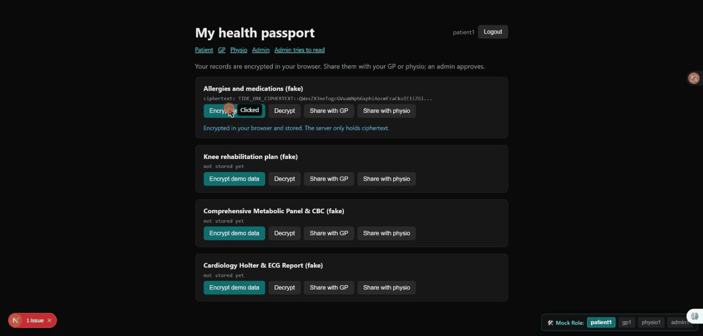

# Care Passport


**Team GoldenToads, FPT University.** Group name: `FPT_SGS_GoldenToads_C2`. UNLOCKED hackathon (RMIT x Tide), Challenge 2: vibe code a working app with TideCloak.

A patient keeps control of their health records: records are encrypted in the browser, the patient shares them with a GP or a physio, and **a realm admin cannot read them**. All data in this repo is fake.

## 1. Vision and originality

**Vision.** Health records should follow the patient, and the patient, not a database administrator, should decide who can read them. Care Passport is a "passport" the patient carries: a record is encrypted on the patient's device, and each person who needs it (a GP, a physio) is granted access to that one record, for a limited time, and can lose it again.

**What is original.**
- Access is **per record and per care team**, not "log in and see everything". The patient's records are tied to one group (`/p1-owner`); the people who help the patient sit in another (`/p1-care-team`) with read-only, expiring access.
- **Granting is a signed act, not a database row.** Normally "Dr Lee may read assessment 42" is a row someone with database access can add. Here it is a policy that an admin approves inside the Tide enclave, and the encryption network checks it on every read.
- The demo includes an **"Admin tries to read" button** that attacks our own system, so the claim "even the admin cannot read it" is shown, not just stated.

## 2. Trust constraint insight

**The constraint we designed around:** *do not trust the server, and do not trust any single admin.*

In most health apps the server holds the keys, so anyone who controls the server (an operator, an attacker who breaks in, an admin who is curious) can read every record. We asked: what if the system must stay safe even when the server and the admin are the problem?

| Who or what | What they can do | What they cannot do |
|---|---|---|
| **Our server** | Store ciphertext and signed policies, check who is calling | Decrypt anything. It never holds a key and no route decrypts |
| **Realm admin** | Approve and sign grants in the enclave | Read patient data. The admin is not in the patient's group, so the network refuses (shown in the demo) |
| **A stolen token** | Nothing alone. Tokens are bound to the browser's key (DPoP) | Be replayed from another machine |
| **The patient's GP** | Read only what was shared, until it expires or is revoked | Write, or read other records |

**Honest limit of this insight.** With one admin, that admin can sign a grant for themselves, so the protection against a *malicious admin* is only as strong as the number of admins (the Tide quorum needs several). We ran with one and say so below.

## 3. Value and impact

- **For patients:** one place to hold their own records, and a real choice about who sees them. Sharing with a new physio is a request, not a form handed over.
- **For clinicians:** they see only what a patient shared with them, so there is less data to protect and less to get blamed for if something leaks.
- **For the organisation running the system:** a breach of the server, or an unhappy administrator, does not expose readable records. The server holds only ciphertext, which lowers the cost and the blast radius of an incident.
- **Auditability:** every grant, approval, revocation and admin inspection is written to a log shown on the admin page, so unilateral power is visible.
- **Reach:** the same pattern (one record, one group, a signed grant) fits other sensitive data such as case files, assessments or legal documents.

Health data is among the most sensitive data there is, which is why we chose it. Everything in this repo is fake data; this is a hackathon prototype, not a medical product.

## 4. Why TideCloak matters

TideCloak is not decoration here; the design does not work without it.

- **No single key holder.** Encryption keys are split across the Tide ORK network (20 nodes, 14 needed). There is no master key on our server or on the admin's laptop to steal.
- **A built-in rule engine for "who may read this record".** The contract `RelationshipAttestation:1` checks the caller's group, role, the record tag and the policy on every encrypt and decrypt. We wrote no cryptography and no custom contract.
- **Governed admin changes (IGA).** Adding someone to a group or giving a role is a change request that an admin approves in the enclave, so access cannot be changed quietly.
- **Passwordless sign-in.** The password is entered in the Tide enclave, never in our app or on our server.
- **Sender-constrained tokens (DPoP).** A stolen token cannot be replayed from another browser; the server checks the proof on every API call.

In short: TideCloak decides **who you are and which group you belong to**; the Tide network decides **whether the data opens**. Because the two are separate, even the realm admin cannot read patient data.

## 5. Prototype and storytelling

**The story.** *Nguyen Van A* has a knee injury and a penicillin allergy. A's records live in Care Passport, encrypted on A's own device. A needs a GP and a physio to see them.

1. **A encrypts and shares.** A opens the Patient page, stores the allergy record, and presses *Share with GP*. A request is created.
2. **The care steward approves.** The admin sees the request and signs a short-lived, read-only grant in the Tide enclave. The action is logged.
3. **The GP reads.** *Dr Le Minh* opens the GP page and decrypts the record in the browser.
4. **A revokes.** The grant is removed and the GP is refused on the next read.
5. **The admin tries to read.** The care steward, who can approve grants, presses *Try to read patient records as admin*. The server shows only ciphertext and the Tide network refuses to decrypt.

**What you can see today** (details and honest status in the sections below):
- Part 1, on the real Tide realm: sign-in, the admin signing grants, and the admin being refused by the network.
- Part 2, in simulated mock mode: the full story above, step by step.
- **Not working on the real realm:** encrypt and decrypt through a group policy (see [What is real and what is not](#what-is-real-and-what-is-not)). We chose to show that plainly rather than hide it behind the mock.

## Demo

| Part | What it shows | File |
|---|---|---|
| 1. Real Tide realm | Tide sign-in, admin signs access policies in the enclave, **admin tries to read and is refused by the Tide network** (about 1 min) | [`Care Passport - Google Chrome 2026-10-22 14-36-44.mp4`](<Care Passport - Google Chrome 2026-10-22 14-36-44.mp4>) (stored with Git LFS) |
| 2. Mock mode (simulated) | Encrypt, share, admin approves, GP reads, revoke, GP refused, admin blocked, with a fake Tide | [`care-passport-part2-mock-demo.gif`](care-passport-part2-mock-demo.gif) |

Part 2 is **simulated** (`NEXT_PUBLIC_MOCK=1`). See [What is real and what is not](#what-is-real-and-what-is-not).

Part 2 preview (simulated, fake data; the "Mock Role" bar at the bottom shows it is a mock):



If the Part 1 video does not play in the browser (it is a large file stored with Git LFS), use the "Download" button on its GitHub page, or `git lfs pull` after cloning.

## What each part is for, and how data flows

There are five parts. Each one has one job.

| Part | Job | Where |
|---|---|---|
| **TideCloak realm** | Sign-in (OIDC + DPoP), users, groups, roles, and governed changes (IGA change requests) | Docker container, `scripts/` |
| **Tide ORK network** | Holds the key shares. Encrypts and decrypts only if the contract says yes | Run by Tide, called from the browser |
| **Browser app** (Next.js pages) | Where users act. All encryption and decryption happens here | `src/app/*`, `src/components/*`, `src/lib/tide/relationship.ts` |
| **Server** (Next.js API routes) | Stores ciphertext and signed policies. Checks who is calling. Never decrypts | `src/app/api/*`, `src/lib/care/store.ts`, `src/lib/auth/*` |
| **Mock layer** | A fake Tide inside the browser, for demos and UI work without the realm | `src/lib/mock/*` |

### Flow 1: sign-in
```
Browser -> TideCloak realm -> Tide enclave (user types the Tide password there, not in our app)
Browser <- access token (+ "doken", the Tide credential) bound to the browser's DPoP key
```
The token carries `groups`, `tideuserkey` and the realm roles. Every API call is sent with `secureFetch`, which adds a DPoP proof.

### Flow 2: admin grants access (signs a policy)
```
Admin browser  builds a policy: group, record id, read/write, expiry
Admin browser  -> Tide enclave: admin approves with their Tide credential  (this IS the grant)
Admin browser  -> POST /api/policies  (admin only)  -> server stores the signed policy
```
The server cannot create a valid policy on its own: the network checks the signature on every use.

### Flow 3: patient encrypts, then reads back
```
Patient browser  GET /api/policies?record=...&op=write   -> signed policy
Patient browser  doEncrypt(data, tag = record id, policy) -> Tide ORKs run the contract -> ciphertext
Patient browser  POST /api/records  { id, ciphertext }   -> server stores ciphertext only
...
Patient browser  GET /api/records -> ciphertext;  doDecrypt(ciphertext, tag, policy) -> plaintext (in the browser)
```
The contract `RelationshipAttestation:1` checks, on every ORK: the caller is in the policy's **group**, holds the realm **role** (`_tide_encryptor` to write, `_tide_decryptor` to read), the policy permits that operation, and the data has exactly one tag (the record id).

### Flow 4: share with the GP or physio, and revoke
```
Patient  POST /api/share-requests {record, to}     -> request stored as "pending"
Admin    sees the request on /admin, approves      -> Flow 2 with group /p1-care-team, read-only, 24 h expiry
Admin    adds gp1 / physio1 to group /p1-care-team (TideCloak change request, approved in the enclave)
GP       fetches the care-team policy -> doDecrypt -> reads the record
Revoke:  admin deletes the policy (PATCH status = revoked); remove the user from the group
```
Who is in the group decides who passes the contract, so **whoever controls group membership controls access**.

### Flow 5: "admin tries to read"
```
Admin browser  GET /api/admin/raw   -> server returns ciphertext only (no key exists on the server)
Admin browser  GET /api/policies?record=...  -> 404, no policy names the admin
Admin browser  doDecrypt(ciphertext)         -> Tide ORKs refuse
```
On the real realm this is shown with a **self-encrypted note** (written by a user with their own key, `/selftest`), because the group-policy encrypt path is not working yet (see below). The network answers `encrypted data signature failed` for the admin.

## What is real and what is not

Verified on a real Tide realm (local Docker, IGA, multiAdmin, DPoP strict):

- Tide sign-in for `admin`, `patient1`, `gp1`, `physio1`.
- Groups, roles and role changes as change requests approved in the enclave.
- The admin signs relationship policies in the enclave; the server stores them.
- Self-encryption (no policy) works for `gp1`, and the admin is refused when it tries to decrypt `gp1`'s note.

**Not working on the real realm: encrypt/decrypt through a group policy.** The Tide network answers every ORK with:

```
TIDE-TIDEJS-NET-THRESHOLD_FAILURE ... [TIDE-ORK-INTERNAL-UNEXPECTED] Doken signature failed
  at /Authentication/Key/v1/PreSign?vuid=58848829-8e65-4a8b-8a37-ee5941357cad
```

What we found (2026-10-22):

- It happened for `patient1` (group `/p1-owner`, roles `_tide_encryptor` and `_tide_decryptor`), and for `admin` while it temporarily had that same group and roles. Self-encryption also fails for `patient1`, but works for `gp1`, who has neither the group nor `_tide_encryptor` (an earlier self-encryption success was recorded without noting which account). Our reading is that the fault follows the group or the `_tide_encryptor` role in the credential; this is not proven.
- Ruled out: Tide nodes unreachable, wrong clock, wrong adapter file (matches the live realm), stale policy (re-signed), pending change requests, incognito mode, missing roles or group membership.
- We could not resolve it before the deadline. Needs the Tide team.

So the **share, GP read and revoke flows are implemented but were not seen working on the live network.** Part 2 of the demo shows them in mock mode.

### Mock mode (simulated)

```bash
NEXT_PUBLIC_MOCK=1 npm run dev        # PowerShell: $env:NEXT_PUBLIC_MOCK="1"; npm run dev
```

A floating bar switches role (`patient1`, `gp1`, `physio1`, `admin1`). Crypto is fake, state lives in the browser and is lost on a full page reload (menu links reload the page; switch role on the page you are on, and use client navigation to keep state). Mock mode skips the real enclave signing. Never use it as evidence about Tide.

## Real limits of the design

- **Revoking one record is not instant.** A revoked user who kept a policy copy can use it until it expires (24 h for care-team policies). Removing a user from the group takes effect when they next sign in.
- **One admin can approve their own access.** With a single admin there is no quorum. The default quorum (70% of admins, at least 1) needs several admins; we ran with one.
- **Whoever controls group membership controls access.** Those changes are governed (change requests) but the approver is trusted.
- **The policy list is visible.** Policies name the group and the record id in clear.
- **Mock is not proof.** It imitates the contract; it does not run it.
- All data is fake. This is a hackathon demo, not a medical product.

## Run it

```bash
npm install
npm run init                              # TideCloak (Docker), realm, data/tidecloak.json
bash scripts/care-passport-seed.sh        # demo users and groups
npm run dev                               # http://localhost:3000
npm run typecheck && npm test             # type check and API tests
```

Pages: `/patient`, `/gp`, `/physio`, `/admin`, `/admin-attack`, and `/selftest` (diagnostic: self-encryption, no policy).
Only the machine running the realm can sign in to it. Team members use mock mode.

## Repo map

| Path | Purpose |
|---|---|
| `src/lib/tide/relationship.ts` | Policy building and signing, encrypt, decrypt, error helpers |
| `src/lib/care/` | Fake records, file store (`data/care/`, git-ignored) |
| `src/lib/auth/` | JWT and DPoP verification (`withAuth`, `withRole`) |
| `src/app/api/` | `policies`, `records`, `share-requests`, `vault`, `audit-logs`, `admin/raw` |
| `src/lib/mock/` | Mock Tide for demos |
| `docs/API.md` | API reference |
| `TASKS.md`, `HANDOFF.md` | Team split and hand-off notes |
